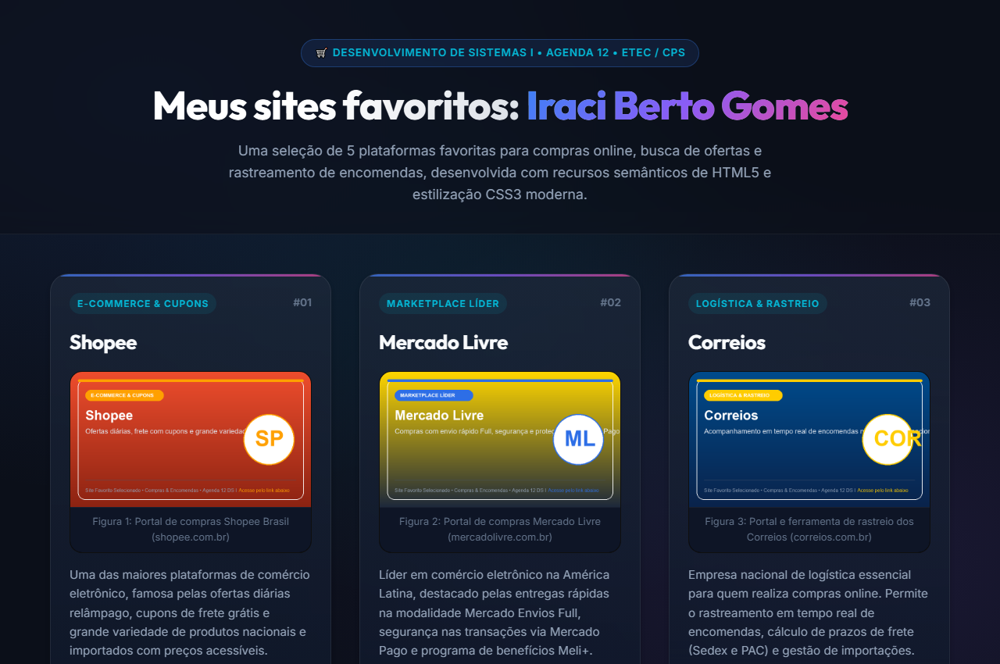
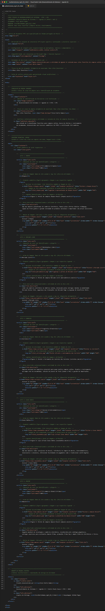

<div align="center">

# 🛒 Meus Sites Favoritos: Compras Online & Rastreamento
### 🚀 Desenvolvimento Web I — Agenda 12 (HTML5 & CSS3) 🚀

[](https://developer.mozilla.org/pt-BR/docs/Web/HTML)
[](https://developer.mozilla.org/pt-BR/docs/Web/CSS)
[](https://bertogomesiraci-33.github.io/AGENDA_12/)
[](https://www.cps.sp.gov.br/)

**Curso Técnico em Desenvolvimento de Sistemas | ETEC / CPS**  
**Componente Curricular:** Desenvolvimento de Sistemas I — Agenda 12  
**Estudante:** Iraci Berto Gomes | **Arquivo de Entrega:** `IraciBertoGomes_Ag12_DS_I.html`  
**Deploy Online:** [https://bertogomesiraci-33.github.io/AGENDA_12/](https://bertogomesiraci-33.github.io/AGENDA_12/)

</div>

---

## 📌 Sobre a Atividade

Atividade avaliativa prática da **Agenda 12** do componente **Desenvolvimento de Sistemas I**, com o propósito de aplicar as competências de marcação semântica com **HTML5** e estilização visual com **CSS3**.

A temática selecionada reúne os **5 sites favoritos de compras online e rastreamento**, fundamentais para buscar ofertas diárias, acompanhar prazos de entrega e adquirir produtos com segurança no cotidiano.

### 🎯 Requisitos Cumpridos
- [x] **Título da Aba (`<title>`):** Configurado exatamente como `"Meus sites favoritos"`.
- [x] **Título do Corpo da Página (`<h1>`):** `"Meus sites favoritos: Iraci Berto Gomes"`.
- [x] **Nome dos Sites:** Cada site com seu respectivo nome acima da imagem utilizando a tag `<h1>`.
- [x] **5 Imagens Locais:** Armazenadas na mesma pasta do arquivo HTML com figuras (`<figure>`) e legendas (`<figcaption>`).
- [x] **Links de Acesso (`<a>`):** Link posicionado abaixo de cada imagem e também clicável na própria imagem (opcional recomendado).
- [x] **Código Comentado:** Todas as tags e seções possuem comentários linha a linha didáticos.
- [x] **Capturas de Tela:** Evidências registradas tanto da execução no navegador quanto do código-fonte.
- [x] **Publicação no GitHub & GitHub Pages:** Repositório versionado com Git e pronto para deploy web.

---

## 🌟 Sites Favoritos Selecionados (Compras & Logística)

| # | Site | Categoria | Finalidade no Cotidiano | Link de Acesso |
| :-: | :--- | :--- | :--- | :--- |
| **01** | **Shopee** | E-commerce & Cupons | Ofertas diárias relâmpago, cupons de desconto, frete grátis e ampla variedade de produtos nacionais e importados. | [Acessar Shopee](https://shopee.com.br) |
| **02** | **Mercado Livre** | Marketplace Líder | Compras com segurança Mercado Pago, variedade de vendedores e entrega ultrarrápida Full. | [Acessar Mercado Livre](https://www.mercadolivre.com.br) |
| **03** | **Correios** | Logística & Rastreio | Ferramenta primordial para rastrear em tempo real encomendas e entregas de todas as lojas online. | [Acessar Correios](https://www.correios.com.br) |
| **04** | **Casas Bahia** | Varejo Tradicional | Compra de eletrodomésticos, móveis, televisores, smartphones e facilidades no carnê digital. | [Acessar Casas Bahia](https://www.casasbahia.com.br) |
| **05** | **Amazon** | E-commerce Global & Prime | Catálogo global de produtos, entrega expressa Amazon Prime, promoções Prime Day, livros e tecnologia. | [Acessar Amazon](https://www.amazon.com.br) |

---

## 💻 Evidências de Execução e Código

### 1. Execução no Navegador Desktop


### 2. Responsividade Mobile


### 3. Código-Fonte HTML5 Comentado


---

## 📂 Estrutura de Pastas e Arquivos

```text
AGENDA_12/
├── IraciBertoGomes_Ag12_DS_I.html    # Arquivo principal exigido no enunciado
├── index.html                        # Arquivo padrão para raiz do GitHub Pages
├── style.css                         # Folha de estilos moderna e responsiva
├── site1_shopee.png                  # Imagem local do site 1 (Shopee)
├── site2_mercadolivre.png            # Imagem local do site 2 (Mercado Livre)
├── site3_correios.png                # Imagem local do site 3 (Correios)
├── site4_casasbahia.png              # Imagem local do site 4 (Casas Bahia)
├── site5_amazon.png                  # Imagem local do site 5 (Amazon)
├── captura-execucao-navegador.png    # Evidência da página aberta no browser
├── captura-execucao-mobile.png       # Evidência da responsividade mobile
├── captura-codigo-html-comentado.png # Evidência do código no VS Code com comentários
├── README.md                         # Documentação completa do repositório
├── publicar_github.bat               # Script facilitador para envio ao GitHub
├── IraciBertoGomes_Ag12_DS_I.docx    # Relatório oficial acadêmico formatado
├── IraciBertoGomes_Ag12_DS_I.pdf     # Relatório oficial em PDF para o fichário
└── IraciBertoGomes_Ag12_DS_I.zip     # Arquivo compactado para submissão
```

---

## 🚀 Como Hospedar no GitHub Pages (Passo a Passo Oficial)

Seguindo o guia didático da ETEC (*como_hospedar_um_site_no_github_pages1.pdf*):

1. **Criar o Repositório no GitHub:**
   - Acesse [https://github.com](https://github.com) e faça login.
   - Crie um novo repositório chamado `AGENDA_12`.
   - Marque a opção **Public** (Público) e clique em **Create repository**.

2. **Enviar os Arquivos:**
   - Dê um duplo clique no arquivo [`publicar_github.bat`](publicar_github.bat) ou use o terminal:
   ```bash
   git init
   git add .
   git commit -m "Atividade Agenda 12 - Meus Sites Favoritos - Iraci Berto Gomes"
   git branch -M main
   git remote add origin https://github.com/bertogomesiraci-33/AGENDA_12.git
   git push -u origin main
   ```

3. **Ativar o GitHub Pages:**
   - No GitHub, acesse a aba **Settings** do repositório `AGENDA_12`.
   - Na barra lateral esquerda, clique em **Pages** (dentro de *Code and automation*).
   - Em **Build and deployment**, selecione a branch `main` e a pasta `/ (root)`.
   - Clique em **Save**.
   - Em poucos minutos, a página estará disponível em:  
     `https://bertogomesiraci-33.github.io/AGENDA_12/`

---

<div align="center">
  <strong>Centro Paula Souza • ETEC • Curso Técnico em Desenvolvimento de Sistemas</strong><br>
  Semestre Letivo 2026 • Aluno: Iraci Berto Gomes
</div>
