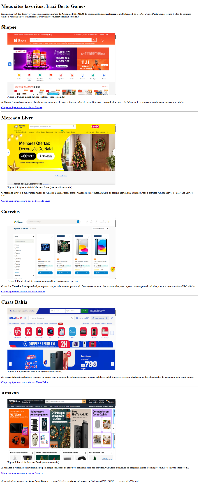

# 🌐 Meus Sites Favoritos
### 📚 Desenvolvimento de Sistemas I — Agenda 12 (HTML5 / Web I)

**Estudante:** Iraci Berto Gomes  
**Componente Curricular:** Desenvolvimento de Sistemas I — Agenda 12  
**Arquivo de Entrega:** `IraciBertoGomes_Ag12_DS_I.html`  
**Site no Ar (GitHub Pages):** [https://bertogomesiraci-33.github.io/AGENDA_12/](https://bertogomesiraci-33.github.io/AGENDA_12/)

---

## 📌 Sobre a Atividade

Atividade prática avaliativa da **Agenda 12**, desenvolvida estritamente com base nos conceitos ensinados na apostila oficial do curso (*agenda_12_web_i_dsi_i_atualizada1_251.pdf*) em HTML5 puro:

- **Estrutura básica de HTML5:** `<!DOCTYPE html>`, `<html lang="pt-br">`, `<head>`, `<meta charset="UTF-8">`, `<meta name="viewport">`, `<title>`, `<body>`.
- **Título principal do corpo:** `<h1>Meus sites favoritos: Iraci Berto Gomes</h1>`.
- **Títulos dos sites:** Uso da tag `<h1>` para o nome de cada site (conforme a dica da atividade).
- **Imagens e legendas:** Uso das tags semânticas `<figure>`, `` (largura de 700px) e `<figcaption>`.
- **Hiperlinks:** Uso da tag `<a>` com atributo `target="_blank"` tanto nas imagens quanto nos links de texto abaixo delas.
- **Linhas divisórias e parágrafos:** Tags `
`, `
`, `<strong>` (negrito) e `<em>` (itálico).
- **Comentários explicativos:** Uso de comentários `<!-- ... -->` explicando as tags e dividindo os blocos de forma enxuta e didática.
- **Padrão curricular:** Código em HTML5 puro, sem estilos CSS (reservados para a Agenda 13).

---

## 🌟 Sites Favoritos Selecionados (Compras & Logística)

| # | Site | Categoria | Descrição | Link Oficial | Imagem Local |
| :-: | :--- | :--- | :--- | :--- | :--- |
| **01** | **Shopee** | E-commerce | Ofertas diárias relâmpago, cupons de desconto e frete grátis. | [Acessar Shopee](https://shopee.com.br/) | `site1_shopee.png` |
| **02** | **Mercado Livre** | Marketplace | Maior marketplace com entregas rápidas Full e segurança Mercado Pago. | [Acessar Mercado Livre](https://www.mercadolivre.com.br/) | `site2_mercadolivre.png` |
| **03** | **Correios** | Logística | Acompanhamento e rastreamento em tempo real de encomendas nacionais e internacionais. | [Acessar Correios](https://www.correios.com.br/) | `site3_correios.png` |
| **04** | **Casas Bahia** | Varejo | Compra de eletrodomésticos, tecnologia, móveis e condições no carnê digital. | [Acessar Casas Bahia](https://www.casasbahia.com.br/) | `site4_casasbahia.png` |
| **05** | **Amazon** | E-commerce | Entregas expressas Prime, catálogo amplo de eletrônicos, livros e promoções. | [Acessar Amazon](https://www.amazon.com.br/) | `site5_amazon.png` |

---

## 💻 Evidências de Execução e Código

### 1. Execução Completa no Navegador

### 2. Código HTML5 Comentado no VS Code (80 Linhas)

---

## 🚀 Como Hospedar no GitHub Pages

Seguindo o guia *como_hospedar_um_site_no_github_pages1.pdf*:
1. Criar repositório público `AGENDA_12` no GitHub.
2. Enviar os arquivos via Git (`git push -u origin main`).
3. Ativar o GitHub Pages em **Settings > Pages > Branch: main / root**.
4. Acessar a página em: **https://bertogomesiraci-33.github.io/AGENDA_12/**

---
**ETEC / Centro Paula Souza • Curso Técnico em Desenvolvimento de Sistemas**
